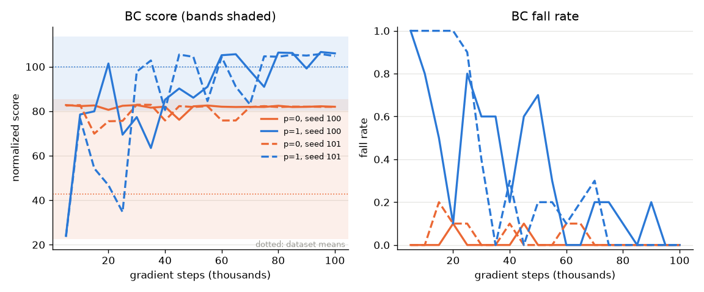

# How Much Expert Data Does Offline RL Need?

Behavior Cloning vs. Implicit Q-Learning on mixed-quality Minari Hopper datasets (CS 5180 project).
Plan and architecture: [ROADMAP.md](ROADMAP.md).

## Setup

### Laptop (Windows, CPU)
```powershell
uv venv --python 3.11 .venv
uv pip install --python .venv\Scripts\python.exe torch==2.11.0 "minari[all]==0.5.4" "gymnasium[mujoco]==1.4.0" mujoco==3.2.3 numpy==2.4.6 pandas==3.1.1 matplotlib==3.11.2 tensorboard==2.21.0 rliable==1.2.0 pytest==9.2.0 ruff==0.17.5
$env:MINARI_DATASETS_PATH = "$PWD\data\minari"
.venv\Scripts\python.exe scripts\smoke.py --datasets
```

### Explorer (Northeastern HPC)
```bash
srun --partition=short --cpus-per-task=4 --mem=8G --time=01:00:00 --pty bash
module load miniconda3/24.11.1
conda env create --prefix /scratch/$USER/envs/offrl -f environment.yml
exit
sbatch slurm/smoke.sbatch
```

## Training and evaluation

```bash
python -m offrl.train configs/algo/bc.yaml seed=100 data.p_expert=1.0 train.steps=100000
python -m offrl.train configs/algo/iql.yaml seed=100 data.p_expert=1.0       # IQL (Phase 5)
python scripts/bc_sanity.py          # Phase 4 sanity runs and checks (on Explorer: sbatch slurm/bc_sanity.sbatch)
```
A run writes `config.yaml`, `meta.json` (commit, packages, GPU, mixture hash), CSV logs, TensorBoard events, a resumable checkpoint and `final.json` to `runs/{algo}_p{p}_s{seed}/`. Pre-flight refuses a mixture whose hash differs from its committed manifest and evaluation seeds that overlap data collection or the reserved final-grid seeds.

## Results so far

**Phase 4, BC sanity (development data, 100k steps, Tesla T4):** all 15 plumbing checks pass ([report](report/phase4/bc_sanity.json), [spec](docs/specs/phase-4-bc-eval.md)).

| Expert fraction `p` | Seed 100 | Seed 101 | Expected band |
|---|---|---|---|
| 0 (simple data only) | 82.1 | 81.9 | 22.5 to 85.4 |
| 1 (expert data only) | 104.4 | 105.5 | 80.3 to 113.5 |



Normalized score: 0 = random policy, 100 = expert dataset mean. Deterministic BC on the simple data scores about 82, well above that dataset's 42.7, because the mean action removes most of its falls.

**Phase 5, IQL validation (development data, 300k steps):** V0, V2, V3 and V4 pass; V1 (IQL within 10 points of BC at `p = 1`) fails and is recorded, 37 of 38 checks ([report](report/phase5/iql_validation.json), [job log](report/phase5/iql_validation_job.log), [spec](docs/specs/phase-5-iql.md) Section 8). The 14 runs trained at `1b0ccbe` and were first analysed with that commit's code; a reanalysis with the checks added in later review (job 12053724, [report](report/phase5/iql_validation_reanalysis.json)) gives the same outcomes and identical numbers. "Ours" is this repository's IQL; "CORL" is CORL's IQL, vendored and run through the same pipeline as the reference.

| `p = 1`, final score | Seed 100 | Seed 101 | Seed 102 | Seed 103 | Seed 104 |
|---|---|---|---|---|---|
| Ours | 81.6 | 89.0 | 103.6 | 83.9 | 104.5 |
| CORL | 99.5 | 104.5 | 104.4 | 103.8 | 103.3 |
| BC | 104.6 | 105.6 | not run | not run | not run |

Seeds 100 and 101 are the registered V1 runs (A100, job array 11981886, analysed by 11981887, which exits 1 on the V1 miss); seeds 102 to 104 are the follow-up the spec fixed in advance for a V1 miss (T4, job 12034721, scored by 12048550, [report](report/phase5/seed_followup.json)). The V1 bar is BC's two-seed mean minus 10, 95.1: ours falls short on 3 of 5 seeds, CORL on 0 of 5. The follow-up rule investigates only if ours trails CORL by more than 5 points on at least 2 of seeds 102 to 104; it does on 1 (seed 103), so **Phase 5 proceeds** and V1's miss is recorded as seed variance. An exploratory same-weights check run afterwards at the user's request (float64, laptop CPU, from seed 103's initial weights and from CORL's seed 103 state at 200k steps) found ours and CORL with identical policy weights and actions at every 50-step check, while a single rounding-sized nudge grew into action differences up to 1.12 within 5,000 steps ([log](report/phase5/same_weights_EXPLORATORY_partial.log)): consistent with seed variance; implementation difference ruled out at the arithmetic level. Five seeds cannot show whether falling short is equally likely for both implementations.

| Seeds 100 and 101, final score | Ours | CORL | BC |
|---|---|---|---|
| `p = 0.2` | 22.8, 10.7 | 12.7, 22.6 | 81.9, 82.1 |
| `p = 0` (simple data only) | 82.2, 82.0 | not run | 82.1, 81.9 (Phase 4, 100k steps) |

At `p = 0.2` both IQL implementations agree (V2: 16.7 vs. 17.6) and fall in 88% to 97% of final evaluation episodes, while BC never falls; both score far below BC. These are development runs that check the plumbing, not the experiment; the comparison across `p` is Phase 6 and later.


## Cluster notes (checked 2026-11-13)

- **Login:** `ssh explorer` (alias for `login.explorer.northeastern.edu`, SSH key auth).
- **Approval:** HPC use for this project approved by the professor whose course allocation provides access, on condition of responsible use (ROADMAP 4.2.1).
- **Slurm account:** `we.shi` (default, no partition restriction, QoS `normal`).
- **GPU partitions:** `gpu` (8 h max), `gpu-short` and `gpu-interactive` (2 h max), `sharing` (1 h max). CPU: `short` (2 days max).
- **GPU gres strings on `gpu` / `gpu-short`:** `t4`, `v100-pcie`, `v100-sxm2`, `a100`, `h200`. This project uses `t4` or `v100-*` only.
- **Modules:** `miniconda3/24.11.1` (also `25.9.1`), `anaconda3/2024.06`, `cuda/12.1.1`, `12.3.0`, `12.8.0`, `13.2.0`.
- **Storage:** code in `~/offline-rl-hopper`; env at `/scratch/$USER/envs/offrl`; datasets at `/scratch/$USER/minari` via `MINARI_DATASETS_PATH`. Scratch is purged monthly: copy results out.

## Verified versions

| Package | Version |
|---|---|
| Python | 3.11.18 |
| torch | 2.11.0 (cu128 on Explorer, CPU on laptop) |
| minari | 0.5.4 |
| gymnasium | 1.4.0 |
| mujoco | 3.2.3 |

Datasets verified: `mujoco/hopper/expert-v0` 999,164 steps / 1,086 episodes; `mujoco/hopper/simple-v0` 999,206 steps / 1,952 episodes; both recover `Hopper-v5` with a 1,000-step limit.

## Credits

`src/offrl/_vendor/corl_iql.py` holds selected, unmodified lines of [CORL](https://github.com/corl-team/CORL)'s IQL (Apache-2.0; license and line ranges in `src/offrl/_vendor/`). It is the reference our IQL is tested against (`tests/test_corl.py`) and is run as `configs/algo/corl_iql.yaml`.
