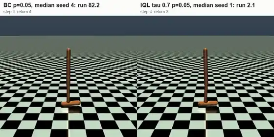
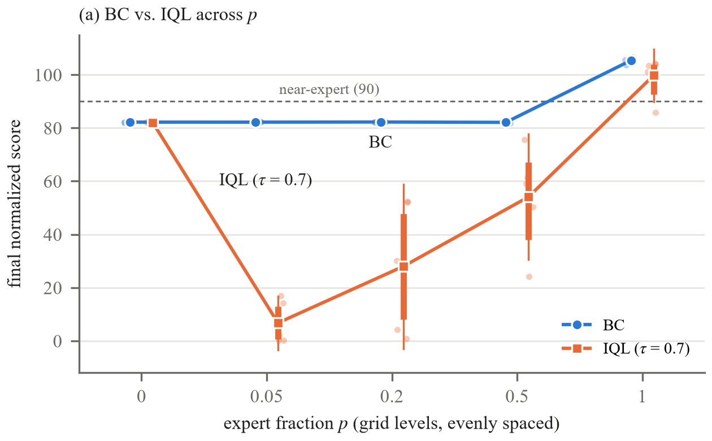
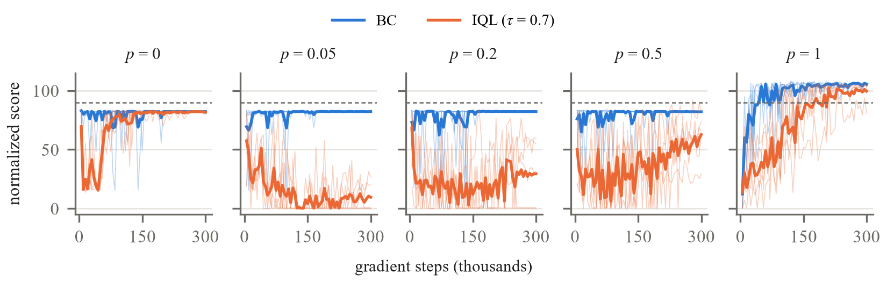
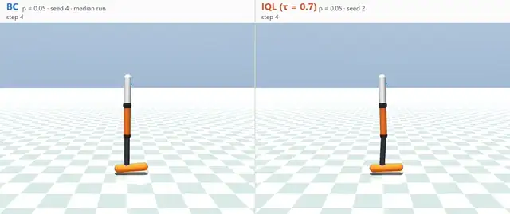
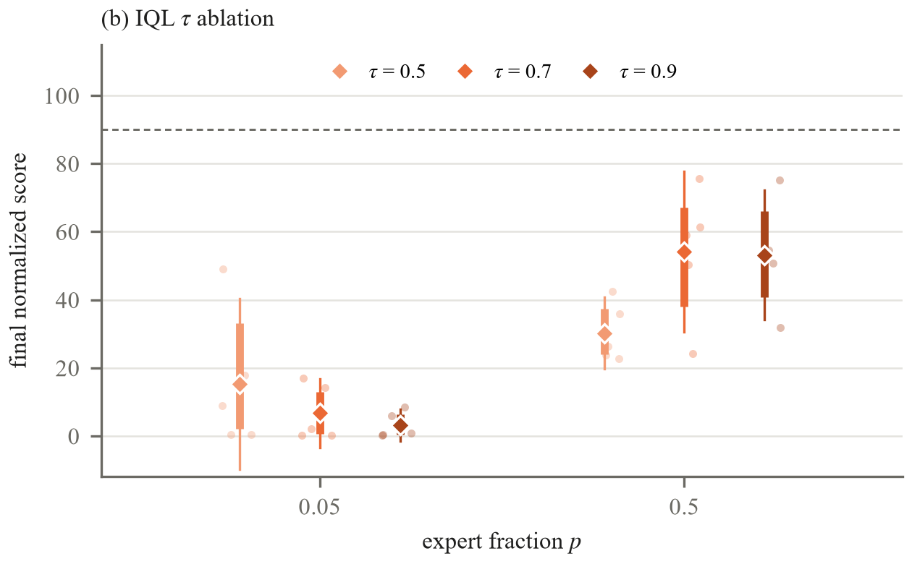

# One Leg, Two Teachers

**Can a robot learn from mixed-quality examples?**

A simulated one-legged robot learns to hop by studying recorded examples, not by practising. Most examples come from a weak performer; a few come from an expert. We compared two learning methods to see how many expert examples each one needs.

*CS 5180 Reinforcement Learning, final project. 70 training runs, 5 repeats per setting, results of 24 Nov 2026.* This is the text version of the interactive [story page](https://rahulvishnuvardhana.github.io/offline-rl-hopper/interactive/), which adds 3D replays of every run; the full write-up is the [report](../report/paper/main.pdf).

*With 5% expert data, BC (left) hops for the full episode while IQL (right) falls after 27 steps. Each is its setting's median-scoring run on the same test episode.*

## 1. Background: the robot and its task

Hopper is a standard simulated robot: one leg with a hip, a knee and an ankle. Its task is to hop forward as far as it can in 1,000 time steps without falling. It falls when its body tilts too far or drops too low.

The robot never practises. It learns only from recordings of other robots. This is called *offline learning*, and it matters wherever trial and error would be slow, costly or unsafe.

| | |
|---|---|
| **3** | joints it controls |
| **1,000** | time steps per attempt |
| **100** | expert's score (0 = random movement) |
| **42.7** | weak performer's score |

## 2. Experiment: mixing expert and weak examples

Each training set holds 900,000 recorded moves. One setting, the **expert share**, decides how many come from the expert: 0%, 5%, 20%, 50% or 100%. At 5%, only 1 move in 20 is an expert move.

- **Behavior cloning (BC)** copies every recorded move. It treats expert and weak examples the same.
- **Implicit Q-Learning (IQL)** also copies, but first estimates which moves lead to better outcomes and copies those more. In principle, it can find the expert moves in a mostly weak pile.

Everything else is identical, so any difference between the two comes from that one idea.

## 3. Method: three predictions, fixed in advance

Before running anything, we wrote down three predictions and an exact test for each ([pre-registration](preregistration.md)). Every setting was trained 5 times from different random starts; a prediction counts as confirmed only if all 5 agree.

- **H1** BC improves as the expert share grows.
- **H2** IQL reaches expert-level play (score 90) with a much smaller expert share than BC.
- **H3** IQL's "pickiness" setting (τ) matters more when expert examples are rare (5%) than when they are common (50%).

All 70 runs used the same code on identical computers (Northeastern's Explorer cluster): 3 hours in total, with no failed runs.

## 4. Result: expert data helps BC only at 100%, and IQL breaks down

*Final score of each setting, 5 runs each. Dots are individual runs, bars are 95% ranges, the dashed line is expert level (90).*

BC scores about 82 at every expert share up to 50%. It copies the weak performer, but more steadily, so it never falls. With 100% expert data it reaches 105.

IQL matches BC when there is no expert data. At a 5% share its score collapses to 6.7. It recovers as the share grows, but stays below BC even at 100%.

| Expert share | 0% | 5% | 20% | 50% | 100% |
|---|---|---|---|---|---|
| BC | 82.2 | 82.2 | 82.2 | 82.1 | **105.4** |
| IQL | 82.0 | 6.7 | 28.0 | 54.1 | **99.7** |

## 5. Training: IQL gets worse the longer it trains

*Score during training, measured every 5,000 training steps; thin lines are runs, thick lines their average.* At a 5% expert share, IQL is at its best at the very start (57.4) and ends at 9.5. BC settles near 82 early and stays there.

## 6. Explore: watch two robots side by side

The interactive [story page](https://rahulvishnuvardhana.github.io/offline-rl-hopper/interactive/) replays any run in 3D, side by side, from the real test attempts checked against the logs. In this text version, the median-run demo above is the clearest contrast. A second example, chosen by hand and not typical, shows IQL hopping for about 600 steps before falling:

*Same 5% share and test episode, a different IQL run (seed 2). It is a laptop re-render: the logged episode falls at step 613, this one at 622, because floating-point differences between computers grow over a long episode. See the [README](../README.md) for details.*

## 7. Verdict: what the predictions show

| | Prediction | Per-run differences | Verdict |
|---|---|---|---|
| **H1** | BC improves as the expert share grows. | BC(100%) minus BC(0%): +23.2, +21.3, +24.1, +23.0, +24.4; mean +23.2, P = 0.031 | **Confirmed** |
| **H2** | IQL reaches expert level (90) with a much smaller expert share than BC. | IQL minus BC at 100%: −4.4, −0.1, −2.2, −19.4, −2.3; mean −5.7 | **Did not hold** |
| **H3** | IQL's pickiness setting (τ) matters more when expert examples are rare. | contrast per run: −61.6, −22.6, −57.2, −38.2, +4.6; mean −35.0, P = 0.969 | **Not enough evidence** |

**H1.** BC scored higher with 100% expert data than with none on all 5 runs (82.2 to 105.4 on average). The rise comes only at the end: up to a 50% share, BC stays at about 82.

**H2.** The data went against it. Both methods reach 90 only at 100% expert data, and even there IQL is 5.7 points behind BC, on all 5 runs. At every share in between, IQL is far worse.

**H3.** On average the data points the opposite way: raising τ from 0.5 to 0.9 hurt at a 5% share and helped at 50%.

| Expert share | τ 0.5 | τ 0.9 | Effect of raising τ |
|---|---|---|---|
| 5% | 15.3 | 3.2 | **−12.1** (hurt) |
| 50% | 30.2 | 53.1 | **+22.9** (helped) |

The rule, fixed in advance, needs all 5 runs to agree before calling a result in either direction. Four runs pointed the opposite way and one went the predicted way, so the test cannot rule out chance. With 5 runs, all 5 lining up by luck happens 1 time in 32 (about 3%); allowing one exception would raise that to about 19%.

"Not enough evidence" means the test could not tell, not that there is no effect; more runs could settle it. The three tests are not adjusted for being run together.

## 8. Limitations

- One robot and one pair of recordings. The weak recordings are good enough that copying them scores 82, which makes copying hard to beat.
- IQL used standard settings, not tuned for mixed data. Why it breaks down was not part of the pre-registered tests. A check after the results, on a few runs, suggests a candidate reason, not a finding: with 5% expert data, IQL copies the expert's first move and then cannot keep up the expert's hopping pattern; with 20% or more, it follows that pattern less closely than BC does.
- Two IQL settings were still changing at the end of training, but not because they were still learning: by then the learning rate was below 2% of its starting value. Their scores jump between checkpoints, which points to fragile late policies. Whether longer training would change the results was not tested.
- IQL was checked against a reference implementation, but both used the same data preparation.

---

Data and code: this repository ([report/phase7](../report/phase7)). Score = 100 × (result − random) / (expert − random).
